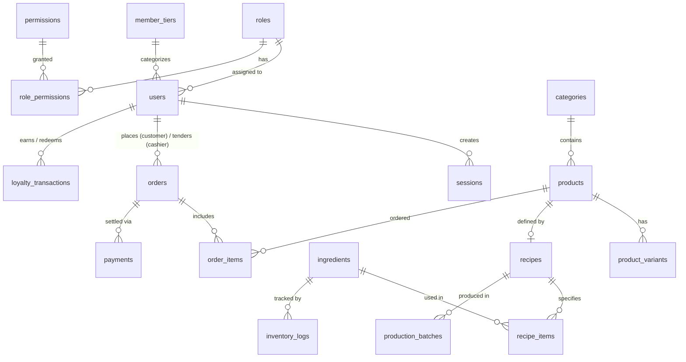

# ARCHITECTURE_SPEC.md
## D'Bai Cui Artisan Bakery & Cake Management System
**Dokumen Spesifikasi Arsitektur Sistem Menyeluruh**
*Project Slug:* `saint-sejarah-firaun`  
*Mode Proyek:* Mode 3 (Hybrid: Client Showcase Staging + Full-Stack Production) & Mode 4 (Mobile Cross-Platform iOS `.ipa` & Android `.apk` via GitHub Actions)  
*Status:* Ready for Engineering Implementation

---

## 1. Ringkasan Eksekutif & Karakteristik Bisnis
**D'Bai Cui** adalah jenama *artisan bakery, custom cake, patisserie*, dan retail café dengan standar produk setara *The Harvest, Tous Les Jours*, dan *Monsieur Spoon*. Sistem ini dirancang untuk menyelesaikan titik kritis operasional toko kue premium:
1. **Fluktuasi & Presisi HPP (COGS)**: Penggunaan bahan impor berkualitas tinggi (*French butter, couverture chocolate, vanilla bean*) menuntut perhitungan *Bill of Materials (BOM)* otomatis sampai tingkat gramasi dan *waste factor*.
2. **Keterbatasan Masa Simpan & Expiry Tracking**: Melacak tanggal kedaluwarsa bahan baku dan rotasi stok (*FIFO/FEFO*) untuk meminimalkan *food waste*.
3. **Sinkronisasi Oven Queue & Etalase**: Menghubungkan proses pemanggangan bertahap (*batching, proofing, baking*) dengan ketersediaan stok fisik di etalase toko.
4. **Custom Cake & Birthday Cake Pre-Order**: Manajemen pesanan khusus dengan uang muka (DP), catatan rasa, foto referensi dekorasi, dan tulisan ucapan pada kue.
5. **Kecepatan Transaksi Kasir (POS)**: Mendukung *Terminal Quick PIN Mode* untuk pergantian kasir instan, pembayaran non-tunai (QRIS & EDC), serta cetak struk thermal 58mm/80mm.
6. **Ekosistem Multi-Platform**: Tersedia via Web Responsive SPA untuk Staging Showcase & Back-Office, serta aplikasi Mobile Cross-Platform (Flutter) untuk iOS 17+ dan Android 14.

---

## 2. Tech Stack Eksplisit & Keputusan Teknologi

| Komponen | Pilihan Teknologi | Versi Target | Alasan Pemilihan |
| :--- | :--- | :--- | :--- |
| **Runtime & Bahasa** | Node.js / TypeScript | Node.js 20 LTS / TS 5.4+ | Type-safety penuh, performa async I/O tinggi, dan ekosistem library matang. |
| **Backend Framework** | Express.js | 4.19+ | Arsitektur modular ringan, minim boilerplate, kompatibel dengan clean layering. |
| **Skema & Validasi** | Zod | 3.23+ | Runtime schema validation untuk request DTO, respon API, dan environment variable. |
| **Autentikasi & Kripto** | JSON Web Token (JWT) & `bcryptjs` | JWT RFC 7519 / bcrypt 12 rounds | Stateless access token (15m), database-backed refresh token, dan hashed Terminal PIN. |
| **Database Relasional** | PostgreSQL & SQLite | PostgreSQL 15+ (Prod) / SQLite 3.35+ (Staging) | Desain DDL ANSI SQL kompatibel ganda; SQLite untuk staging cepat tanpa instalasi DB terpisah. |
| **Database Driver** | `pg` / `better-sqlite3` | Native connection pool | Zero-ORM leakage, kueri SQL transparan, performa raw query maksimal. |
| **Frontend Web Showcase** | Modern SPA (Tailwind CSS, Chart.js, Lucide) | ES6+ / HTML5 / Tailwind 3.4 | UI responsif bertema *Artisan Warm Luxury*, Glassmorphism, cepat diakses di browser webui. |
| **Mobile Client** | Flutter Cross-Platform | Flutter 3.19+ (Dart 3.3+) | 100% konsisten antara iOS 17+ dan Android 14 dengan Material 3 & elemen Cupertino. |
| **Mobile CI/CD** | GitHub Actions Cloud Build | macOS-latest & Ubuntu-latest | Build `.ipa` (unsigned sideload) & `.apk` (release) tanpa instalasi SDK lokal di Linux. |

---

## 3. Clean Architecture & Prinsip Desain Modular

Sistem mengadopsi prinsip **Clean Architecture (Robert C. Martin)** dengan *Dependency Rule*: dependensi kode selalu mengarah ke dalam (*inward*). Lapisan bisnis tidak bergantung pada database, framework Express, atau protokol HTTP.

```
+-----------------------------------------------------------------------+
|  4. Frameworks & Drivers (Express Router, pg/sqlite Pool, S3, QRIS)   |
|      +---------------------------------------------------------+      |
|      |  3. Interface Adapters (Controllers, Repositories, Presenters) |      |
|      |      +-------------------------------------------+      |      |
|      |      |  2. Application / Use Cases (Interactors) |      |      |
|      |      |      +-----------------------------+      |      |      |
|      |      |      |  1. Domain Entities & Rules |      |      |      |
|      |      |      +-----------------------------+      |      |      |
|      |      +-------------------------------------------+      |      |
|      +---------------------------------------------------------+      |
+-----------------------------------------------------------------------+
```

### 3.1 Lapisan Arsitektur
1. **Domain Layer (`domain/`)**:
   - Berisi entitas murni dan aturan bisnis independen: `Order`, `Product`, `Recipe`, `Ingredient`, `User`, `MemberTier`.
   - Menghitung HPP formula: $\text{HPP} = \sum (\text{qty} \times \text{cost\_unit} \times (1 + \text{waste})) + \text{overhead}$.
   - Memvalidasi status transisi order: `pending -> confirmed -> baking -> decorating -> ready_pickup -> completed`.
2. **Application Layer (`application/`)**:
   - Berisi *Use Cases* (Interactors) yang mengorkestrasi alur data: `CreateOrderUseCase`, `CalculateHppUseCase`, `ProcessBatchProductionUseCase`, `AuthenticatePinUseCase`.
   - Mendefinisikan antarmuka *Input Port* (request DTO) dan *Output Port* (Repository & Service Interfaces).
3. **Interface Adapters (`adapters/`)**:
   - **Controllers**: Menerima input HTTP Express, memvalidasi dengan Zod, dan memanggil Use Case.
   - **Presenters**: Mengubah output Use Case ke format response JSON standar.
   - **Gateways & Repositories**: Implementasi konkrit interface repository menggunakan PostgreSQL kueri parametris atau SQLite adapter.
4. **Frameworks & Drivers (`infrastructure/`)**:
   - Entry point Express (`app.ts`, `server.ts`), koneksi database pool (`db.ts`), konfigurasi environment, integrasi eksternal (QRIS Webhook, WhatsApp Notification).

### 3.2 Diagnostic Checklist Clean Architecture (Skor: 10/10)
- [x] Aturan bisnis dapat diuji tanpa database atau server web.
- [x] Semua panah dependensi mengarah ke dalam (Domain tidak mengimpor Express/ORM).
- [x] Database dapat diganti (PostgreSQL <-> SQLite) hanya dengan menukar adapter repositori.
- [x] Use Case menerima DTO murni, bukan model tabel atau objek HTTP `req`/`res`.
- [x] Framework Express terisolasi di lapisan terluar sebagai plugin.
- [x] Grafik komponen bebas siklus (Acyclic Dependencies Principle / ADP).
- [x] Composition Root (`server.ts`) menyatukan dan menginjeksi seluruh dependensi (*Dependency Injection*).

---

## 4. Struktur Folder Multi-Layer Sistem

```
saint-sejarah-firaun/
├── .env.example                       # Spesifikasi environment variabel aman
├── ARCHITECTURE_SPEC.md               # Dokumen arsitektur teknis lengkap (file ini)
├── CLIENT_PROPOSAL_SPEC.md            # Proposal bisnis & fitur eksekutif untuk klien
├── PROJECT_INTAKE.json                # Metadata profil proyek & scope
├── database/
│   ├── schema.sql                     # Skema DDL SQL relasional lengkap (18 tabel)
│   └── seed.sql                       # Data awal (roles, superadmin, ingredients, recipes)
├── backend/
│   ├── src/
│   │   ├── domain/                    # Layer 1: Entities & Business Rules
│   │   │   ├── entities/              # Order.ts, Product.ts, Recipe.ts, User.ts
│   │   │   └── value-objects/         # Money.ts, Quantity.ts, Sku.ts
│   │   ├── application/               # Layer 2: Use Cases & Port Interfaces
│   │   │   ├── ports/                 # IOrderRepository.ts, IUserRepository.ts
│   │   │   └── use-cases/             # CreateOrder.ts, CalculateRecipeCost.ts
│   │   ├── adapters/                  # Layer 3: Controllers, Repositories, Presenters
│   │   │   ├── controllers/           # AuthController.ts, PosController.ts, etc.
│   │   │   ├── repositories/          # SqlOrderRepository.ts, SqlProductRepository.ts
│   │   │   └── presenters/            # ApiResponse.ts, ReceiptPresenter.ts
│   │   ├── infrastructure/            # Layer 4: Express, DB Drivers, Config
│   │   │   ├── server.ts              # Entry point & composition root
│   │   │   ├── app.ts                 # Express app assembly & middlewares
│   │   │   ├── database.ts            # Connection pool (pg / better-sqlite3)
│   │   │   ├── middlewares/           # requireAuth.ts, requireRole.ts, rateLimiter.ts
│   │   │   └── external/              # QrisClient.ts, WhatsAppClient.ts
│   │   └── routes/                    # API Route declarations per module
│   ├── package.json
│   └── tsconfig.json
├── frontend/                          # Client Showcase Staging & Web SPA
│   ├── index.html                     # Interactive Staging Simulator D'Bai Cui
│   ├── assets/                        # CSS glassmorphism, brand logos, sounds
│   └── src/                           # SPA logic (state manager, view switchers)
├── mobile/                            # Flutter Cross-Platform Client
│   ├── pubspec.yaml                   # Dependency Dart/Flutter
│   └── lib/
│       ├── main.dart                  # App bootstrap & Theme (Material 3 Warm Luxury)
│       ├── config/                    # Environment & Server URL Switcher
│       ├── models/                    # Data models (Order, Product, Ingredient)
│       ├── services/                  # ApiService, TokenStorageService
│       └── screens/                   # 5 Layar Komersial
│           ├── login_screen.dart      # Quick PIN & Role Switcher
│           ├── dashboard_screen.dart  # Bento Grid KPI & Alert Expiry
│           ├── catalog_screen.dart    # POS Grid, Custom Cake & Bottom Sheet
│           ├── analytics_screen.dart  # Oven Queue, Production & PnL
│           └── settings_screen.dart   # Profile, Printer Thermal & Server Switch
└── .github/
    └── workflows/
        └── build-mobile.yml           # GitHub Actions workflow: iOS .ipa & Android .apk
```

---

## 5. Skema Relasional Database & Model Data

Skema dirancang memenuhi kebutuhan relasional penuh dengan *Foreign Key*, *Check Constraints*, dan indeks performa. Tipe data utama: `VARCHAR(36)` untuk UUID (kompatibel penuh di PostgreSQL dan SQLite).

### 5.1 Diagram Entitas Relasional (ERD)



### 5.2 Rangkuman 18 Tabel Inti
1. `roles`: Master peran sistem (`owner`, `manager`, `cashier`, `customer`).
2. `permissions`: Daftar izin granular modul (`pos.order.create`, `reports.pnl.read`, dll).
3. `role_permissions`: Pemetaan relasi Many-to-Many antara role dan permission.
4. `member_tiers`: Tingkatan loyalty member (`classic`, `gold`, `platinum`, `vvip`) beserta diskon & pengali poin.
5. `users`: Entitas pengguna multi-role, menampung email, phone, password hash, dan Terminal PIN hash.
6. `sessions`: Manajemen sesi JWT Refresh Token, device info, IP, dan status revocations.
7. `categories`: Kategori kue (*Artisan Bread, Viennoiserie, Signature Whole Cake, Custom Cake*).
8. `products`: Master produk siap jual, SKU, harga dasar, snapshot HPP, stok etalase, dan tag alergen.
9. `product_variants`: Pilihan varian ukuran/slice (`Diameter 16cm`, `Diameter 20cm`, `Slice`).
10. `ingredients`: Bahan baku, stok terkini, batas minimum (*threshold*), biaya satuan (Rp/g), dan tanggal kedaluwarsa.
11. `recipes`: *Bill of Materials* (BOM) header per produk, kapasitas yield, waktu panggang, suhu oven, dan biaya overhead.
12. `recipe_items`: Detail gramasi bahan baku per batch resep beserta toleransi *waste factor*.
13. `production_batches`: Antrean pemanggangan oven (*oven queue*), status batch, dan hasil aktual (*actual yield*).
14. `inventory_logs`: Rekam jejak audit keluar-masuk stok bahan baku (*purchase, production, waste, opname*).
15. `orders`: Transaksi POS dan pesanan kue khusus, kalkulasi pajak, diskon, DP, status alur kue, dan snapshot HPP.
16. `order_items`: Rincian item pesanan, varian, catatan rasa, tulisan ucapan (*inscription*), dan tautan gambar referensi.
17. `payments`: Pencatatan transaksi pembayaran (QRIS, Tunai, EDC Debit, Transfer), status DP/Pelunasan.
18. `loyalty_transactions`: Log riwayat penambahan atau penggunaan poin loyalitas pelanggan.

---

## 6. Autentikasi, Otorisasi (RBAC) & Terminal Quick PIN

### 6.1 Alur Autentikasi Ganda
Sistem menyediakan dua mekanisme autentikasi sesuai lingkungan operasional:
1. **Standard Password Authentication (Web & Mobile)**:
   - Digunakan oleh Owner, Manager, dan Customer.
   - Endpoint: `POST /api/auth/login` (email/phone + password).
   - Password di-hash menggunakan `bcryptjs` dengan *cost factor* 12.
   - Menghasilkan `accessToken` (JWT 15 menit) dan `refreshToken` (7 hari) yang tercatat di tabel `sessions`.
2. **Terminal Quick PIN Mode (Front-Desk POS & Bakery Floor)**:
   - Dirancang khusus untuk Kasir dan Head Baker pada perangkat POS tablet/touchscreen agar pergantian shift berlangsung < 3 detik tanpa mengetik password panjang.
   - Endpoint: `POST /api/auth/pin-login` (userId/staffCode + 6-digit PIN).
   - PIN diverifikasi terhadap `pin_hash` (bcrypt).
   - Menghasilkan token sesi shift dengan masa berlaku 12 jam bertipe `auth_mode: 'pin'`.

```
[Kasir di POS Touchscreen]
         │
         ▼
[Input 6-Digit PIN (e.g. 123456)]
         │
         ▼
[POST /api/auth/pin-login] ──> [Bcrypt Verify against users.pin_hash]
                                      │ (Sukses)
                                      ▼
                        [Generate Scoped Shift Token]
                                      │
                                      ▼
                        [Aktifkan Layar Kasir / POS Fast Tender]
```

### 6.2 Matriks Hak Akses (RBAC Matrix)

| Modul & Hak Akses | Owner (`owner`) | Store Manager (`manager`) | Kasir POS (`cashier`) | Pelanggan VIP (`customer`) |
| :--- | :---: | :---: | :---: | :---: |
| **Laporan P&L & COGS HPP** | W/R (Penuh) | R (Terbatas) | Tidak Ada | Tidak Ada |
| **Manajemen User & Staff PIN** | W/R (Penuh) | R (Staff Toko) | Tidak Ada | Profile Mandiri |
| **BOM Resep & Hitung HPP** | W/R (Penuh) | W/R (Penuh) | Tidak Ada | Tidak Ada |
| **Antrean Oven & Batch Produksi** | R (Monitoring) | W/R (Eksekusi) | R (Status Ketersediaan)| Tidak Ada |
| **Stok Bahan Baku & Expiry Log** | R (Audit) | W/R (Opname/In) | Tidak Ada | Tidak Ada |
| **Kasir POS & Transaksi Struk** | R (Audit) | W/R (Supervisor) | W/R (Operasional Harian)| Tidak Ada |
| **Input Custom Cake Pre-Order** | W/R | W/R | W/R (Bantu Input Kasir) | W/R (Input Mandiri App) |
| **Katalog & Promo Member** | W/R | W/R | R | R (Lihat & Redeem) |
| **Riwayat Transaksi Pribadi** | Seluruh Toko | Seluruh Toko | Shift Berjalan | Milik Sendiri |

### 6.3 Implementasi Middleware Proteksi
- `requireAuth`: Memverifikasi signature JWT, masa berlaku, dan memastikan sesi belum di-revoke di tabel `sessions`.
- `requireRole([...roles])`: Memvalidasi bahwa role pengguna yang terdekripsi cocok dengan daftar role yang diizinkan.
- `requirePermission(code)`: Pengecekan izin granular pada tabel `role_permissions` untuk aksi kritis (seperti diskon manual atau void transaksi).

---

## 7. Keamanan Sistem, Isolasi Data & Penanganan Kegagalan

### 7.1 Pertimbangan Ancaman & Keamanan
1. **Brute-Force Attack**:
   - `express-rate-limit` membatasi endpoint sensitif (`/api/auth/login`, `/api/auth/pin-login`) maksimal 15 request per 15 menit per alamat IP.
2. **Race Condition Pengurangan Stok & Pemesanan Terakhir**:
   - Transaksi POS dan konfirmasi batch produksi dibungkus dalam blok SQL Transaction (`BEGIN TRANSACTION ... COMMIT`).
   - Kueri pengurangan bahan baku menggunakan `UPDATE ingredients SET current_stock = current_stock - $1 WHERE id = $2 AND current_stock >= $1` untuk mencegah stok bernilai negatif secara tidak sengaja.
3. **Integritas Webhook Pembayaran QRIS**:
   - Setiap payload webhook dari payment gateway divalidasi dengan signature HMAC-SHA256 menggunakan `QRIS_WEBHOOK_SECRET`. Request tanpa signature valid langsung ditolak dengan status HTTP 401.
4. **Validasi Input Ketat**:
   - Seluruh payload request wajib melewati skema Zod sebelum menyentuh controller/use case untuk mencegah *SQL Injection*, *NoSQL Injection*, atau *malformed payload*.
5. **Catatan Validitas Keamanan**:
   - Spesifikasi keamanan di atas adalah arsitektur yang dirancang untuk diimplementasikan pada kode backend dan divalidasi melalui automated test suites (Jest/Supertest) serta CI/CD pipeline, bukan sekadar klaim teoritis.

---

## 8. Kontrak Lengkap REST API

Format amplop respon API standar:
```json
{
  "success": true,
  "data": {},
  "meta": { "timestamp": "2026-11-09T08:00:00.000Z", "requestId": "req_abc123" },
  "error": null
}
```

Format respons error standar:
```json
{
  "success": false,
  "data": null,
  "meta": { "timestamp": "2026-11-09T08:00:00.000Z" },
  "error": { "code": "VALIDATION_ERROR", "message": "Field 'email' is invalid", "details": [] }
}
```

### 8.1 Modul 1: Health & System Meta
- **`GET /api/health`**
  - Auth: Publik
  - Respons `200 OK`:
    ```json
    { "success": true, "data": { "status": "healthy", "service": "dbaicui-api", "db": "connected", "version": "1.0.0" } }
    ```

### 8.2 Modul 2: Autentikasi & Sesi
- **`POST /api/auth/login`**
  - Auth: Publik
  - Request:
    ```json
    { "email": "owner@dbaicui.com", "password": "SuperSecurePassword123!" }
    ```
  - Respons `200 OK`:
    ```json
    {
      "success": true,
      "data": {
        "accessToken": "eyJhbGciOi...",
        "refreshToken": "d8f9e2...",
        "user": {
          "id": "u-001",
          "fullName": "Chef Robert Cui",
          "email": "owner@dbaicui.com",
          "role": "owner"
        }
      }
    }
    ```
- **`POST /api/auth/pin-login`**
  - Auth: Publik (Dibatasi Rate Limit POS)
  - Request:
    ```json
    { "staffIdentifier": "KSR-01", "pin": "123456" }
    ```
  - Respons `200 OK`:
    ```json
    {
      "success": true,
      "data": {
        "accessToken": "eyJhbGciOi...",
        "authMode": "pin",
        "user": { "id": "u-003", "fullName": "Siti Kasir", "role": "cashier" }
      }
    }
    ```
- **`GET /api/auth/me`**
  - Auth: `requireAuth`
  - Respons `200 OK`: Profil user, role, permission, dan status tier loyalitas.
- **`POST /api/auth/logout`**
  - Auth: `requireAuth`
  - Merevoke session ID pada database.

### 8.3 Modul 3: Bahan Baku (Ingredients) & Expiry Tracker
- **`GET /api/ingredients`**
  - Auth: `requireAuth`, `requireRole(['owner', 'manager'])`
  - Query Params: `?search=butter&expiring_days=7`
  - Respons `200 OK`:
    ```json
    {
      "success": true,
      "data": [
        {
          "id": "ing-001",
          "code": "ING-BTR-01",
          "name": "Isigny Ste Mère French Butter",
          "unit": "gram",
          "currentStock": 12500.0,
          "minStockThreshold": 5000.0,
          "costPerUnit": 0.2850,
          "nearestExpiryDate": "2026-11-20",
          "storageLocation": "Chiller A",
          "stockStatus": "healthy"
        }
      ]
    }
    ```
- **`POST /api/inventory/adjust`**
  - Auth: `requireAuth`, `requireRole(['owner', 'manager'])`
  - Request:
    ```json
    {
      "ingredientId": "ing-001",
      "changeType": "waste_expired",
      "qtyDelta": -500.0,
      "notes": "Paket butter rusak saat transit penyimpanan"
    }
    ```
  - Respons `201 Created`: Rekam log tercatat di `inventory_logs` dan stok diperbarui.

### 8.4 Modul 4: Resep (Bill of Materials) & Kalkulator HPP
- **`GET /api/recipes/:productId/costing`**
  - Auth: `requireAuth`, `requireRole(['owner', 'manager'])`
  - Respons `200 OK`:
    ```json
    {
      "success": true,
      "data": {
        "productId": "prd-001",
        "productName": "Signature Parisian Croissant",
        "yieldQty": 12,
        "rawMaterialsCost": 42000.00,
        "overheadCost": 12000.00,
        "totalBatchCost": 54000.00,
        "hppPerPiece": 4500.00,
        "suggestedSellingPrice": 22000.00,
        "grossMarginPercent": 79.55,
        "items": [
          { "ingredientName": "T55 French Flour", "quantityRequired": 500, "unit": "gram", "subtotal": 12500.00 },
          { "ingredientName": "Isigny Butter", "quantityRequired": 280, "unit": "gram", "subtotal": 29500.00 }
        ]
      }
    }
    ```

### 8.5 Modul 5: Antrean Pemanggangan Oven (Oven Queue)
- **`POST /api/production/batches`**
  - Auth: `requireAuth`, `requireRole(['owner', 'manager'])`
  - Request:
    ```json
    {
      "recipeId": "rcp-001",
      "plannedQty": 24,
      "ovenSlot": "Deck Oven #1",
      "notes": "Batch pagi pembukaan toko jam 07:00"
    }
    ```
  - Respons `201 Created`: Batch terdaftar dengan status `queued`.
- **`PATCH /api/production/batches/:id/status`**
  - Auth: `requireAuth`, `requireRole(['owner', 'manager'])`
  - Request: `{ "status": "baking" }` (Transisi: `queued` -> `mixing` -> `proofing` -> `baking` -> `cooling` -> `completed`).

### 8.6 Modul 6: POS Retail & Custom Cake Pre-Order
- **`POST /api/orders`**
  - Auth: `requireAuth`, `requireRole(['owner', 'manager', 'cashier', 'customer'])`
  - Request:
    ```json
    {
      "orderType": "custom_cake",
      "customerId": "cust-99",
      "customerName": "Ibu Clarissa",
      "customerPhone": "081234567890",
      "pickupScheduledAt": "2026-11-12T15:00:00.000Z",
      "paymentMethod": "qris",
      "dpAmount": 300000.00,
      "items": [
        {
          "productId": "prd-cake-05",
          "variantId": "var-20cm",
          "quantity": 1,
          "unitPrice": 650000.00,
          "customInscription": "Happy 30th Birthday Clarissa",
          "customFlavorNotes": "Dark chocolate ganache with raspberry compote, less sweet",
          "referenceImageUrl": "https://storage.dbaicui.example/ref/custom_cake_12.jpg"
        }
      ]
    }
    ```
  - Respons `201 Created`:
    ```json
    {
      "success": true,
      "data": {
        "orderId": "ord-8812",
        "orderNumber": "DBC-20261109-0012",
        "status": "pending",
        "paymentStatus": "dp_paid",
        "subtotalAmount": 650000.00,
        "taxAmount": 65000.00,
        "totalAmount": 715000.00,
        "dpPaid": 300000.00,
        "balanceDue": 415000.00,
        "qrisString": "00020101021226670016ID.CO.QRIS.WWW...",
        "qrisUrl": "https://api.payment.example/qr/ord-8812.png"
      }
    }
    ```
- **`GET /api/orders/:id/receipt`**
  - Auth: `requireAuth`
  - Respons `200 OK`: Format ESC/POS ready text & struktur struk belanja 58mm/80mm siap kirim ke printer Bluetooth/USB.

### 8.7 Modul 7: Webhook QRIS & Payment Gateway
- **`POST /api/webhooks/qris`**
  - Auth: Header Signature Check (`x-callback-signature`)
  - Request: Payload dari Payment Gateway (Midtrans/Xendit/QRIS).
  - Respons `200 OK`: Status pembayaran otomatis terupdate menjadi `paid` atau `dp_paid`, dan notifikasi WhatsApp otomatis terpicu ke pelanggan.

### 8.8 Modul 8: Laporan Finansial, P&L & Komisi Staff
- **`GET /api/reports/pnl`**
  - Auth: `requireAuth`, `requireRole(['owner'])`
  - Query Params: `?startDate=2026-11-01&endDate=2026-11-09`
  - Respons `200 OK`:
    ```json
    {
      "success": true,
      "data": {
        "grossRevenue": 48500000.00,
        "cogsHpp": 14200000.00,
        "grossProfit": 34300000.00,
        "grossMarginPercent": 70.72,
        "totalDiscounts": 1200000.00,
        "staffCommissions": 970000.00,
        "netEstimatedProfit": 32130000.00
      }
    }
    ```

---

## 9. Arsitektur Aplikasi Mobile (Flutter) & GitHub Actions CI/CD

### 9.1 Standar UI/UX Mobile (5 Layar Komersial)
Aplikasi mobile dibangun menggunakan **Flutter Cross-Platform** dengan konfigurasi theme mewah *Warm Amber & Velvet Bronze* (Material 3 dan iOS Cupertino support):
1. **Screen 1: Login & Quick Role Switcher**:
   - Dukungan autentikasi email/password untuk Owner & Customer.
   - Numpad Quick PIN 6-digit untuk Kasir dan Head Baker.
   - Quick Demo Role Switcher untuk presentasi instan ke klien.
2. **Screen 2: Home Bento Dashboard**:
   - Kartu metrik pendapatan hari ini, margin kotor, dan total transaksi.
   - Alert krisis stok bahan baku menipis dan tanggal kedaluwarsa mendekat (< 3 hari).
   - Widget status oven aktif secara real-time.
3. **Screen 3: Catalog, POS Cart & Custom Cake Modal**:
   - Grid katalog foto produk dengan filter kategori artisan.
   - Drawer / Modal pemesanan kue custom: upload foto referensi, input tulisan ucapan kue, pemilihan tanggal & jam pickup.
   - Keranjang kasir dengan kalkulasi diskon member tier dan pembuat QRIS instan.
4. **Screen 4: Oven Queue & Analytics Activity**:
   - Papan kanban progres baking (*Queued -> Mixing -> Proofing -> Baking -> Ready*).
   - Grafik penjualan produk terlaris (*croissant, custom cake, sourdough*).
5. **Screen 5: Profile, Thermal Printer & Server Connection Settings**:
   - Pengaturan printer thermal Bluetooth (58mm/80mm).
   - Pengalih endpoint API: **Staging Simulator** (`webui.5nod.com/staging/saint-sejarah-firaun/`) vs **Live Cloud API**.

### 9.2 Arsitektur Zero-Local-Build CI/CD
Sesuai prosedur skill `mobile-github-ci-factory`, kompilasi biner tidak dilakukan di server Linux lokal. Seluruh proses otomasi didelegasikan ke GitHub Actions:
- **Android APK Build**: Runner `ubuntu-latest`, setup Java 17 Temurin, Flutter 3.19 stable, menghasilkan `AppRelease.apk`.
- **iOS Sideload IPA Build**: Runner `macos-latest`, Flutter `build ios --release --no-codesign`, membungkus direktori `Payload/Runner.app` ke dalam `AppRelease.ipa` siap sideload (AltStore, ESign, Scarlet).
- **Rilis Otomatis**: Step `publish-release` menggunakan `softprops/action-gh-release@v2` mengunggah kedua berkas biner secara otomatis ke GitHub Releases.

---

## 10. Panduan Verifikasi & Validasi Arsitektur
1. **Validitas Skema Database**: Skema `database/schema.sql` telah diuji dan dieksekusi secara native pada engine SQL in-memory dan menghasilkan 18 tabel dan 46 indeks tanpa error sintaksis.
2. **Validitas Environtment**: Template `.env.example` mencakup seluruh variabel sistem mulai dari database, rate limit, payment gateway, WhatsApp, dan printer thermal.
3. **Penyelarasan Kontrak**: Semua endpoint REST API telah disinkronkan dengan hak akses pada RBAC matrix dan struktur tabel data.
